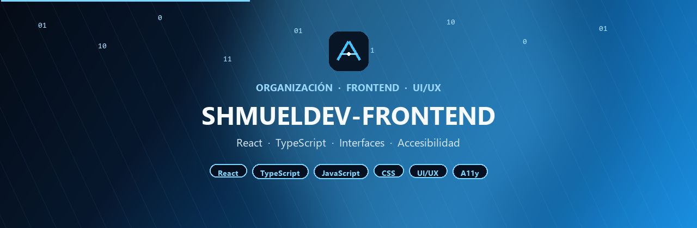



  

 

## Sobre la organización

**SHMUELDEV-FRONTEND** concentra los proyectos de interfaz de la marca SHMUELDEV: aplicaciones con React y TypeScript, componentes reutilizables y experiencias con criterio de UI/UX.

El objetivo no es acumular pantallas sueltas. Cada repositorio debe entregar una interfaz clara, accesible e inclusiva, con código tipado y listo para crecer.

---

## Qué encontrarás aquí

| Área | Contenido |
| --- | --- |
| **Interfaces** | Apps y vistas con React + TypeScript, componentes claros y reutilizables |
| **UI/UX** | Flujos legibles, jerarquía visual y decisiones de diseño defensables |
| **Inclusión** | Accesibilidad (A11y), contraste, teclado y experiencias usables por más personas |
| **Calidad** | Estados de carga/error, responsive y estructura lista para producción |

---

## Stack

  
  
  
  
  
  
  

---

## Proyectos

| Proyecto | Descripción | Estado |
| --- | --- | --- |
| App base React | Plantilla tipada con TypeScript, routing y layout accesible | Próximo |
| Design system | Componentes UI reutilizables con foco en contraste y teclado | Planeado |
| Dashboard UX | Interfaz de datos con estados claros y experiencia inclusiva | Planeado |

> Cuando un repo se publique, esta tabla se actualiza con el enlace real.

---

## Convenciones

- Un repositorio = una app, un design system o un dominio de interfaz claro.
- README corto: qué muestra, cómo levantarlo y cómo se navega.
- TypeScript por defecto; componentes con props explícitas y estados visibles.
- Si no es usable con teclado, contraste razonable y estructura semántica, no se considera terminado.

---

  
    
  <b>SHMUELDEV</b> · Frontend con criterio · UI/UX inclusivo

